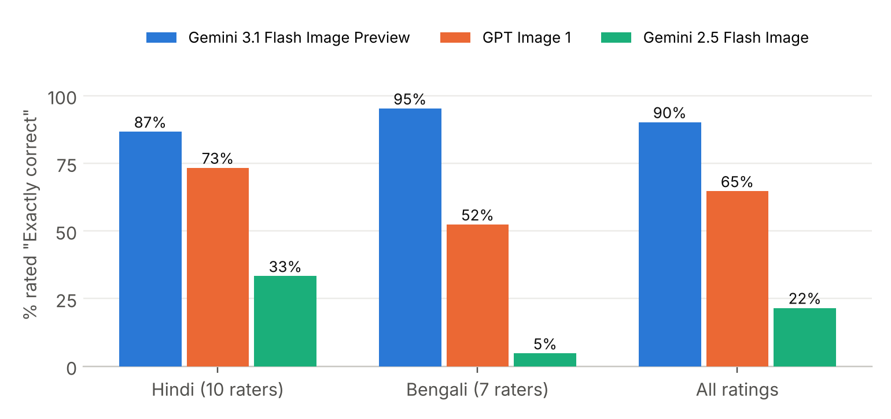
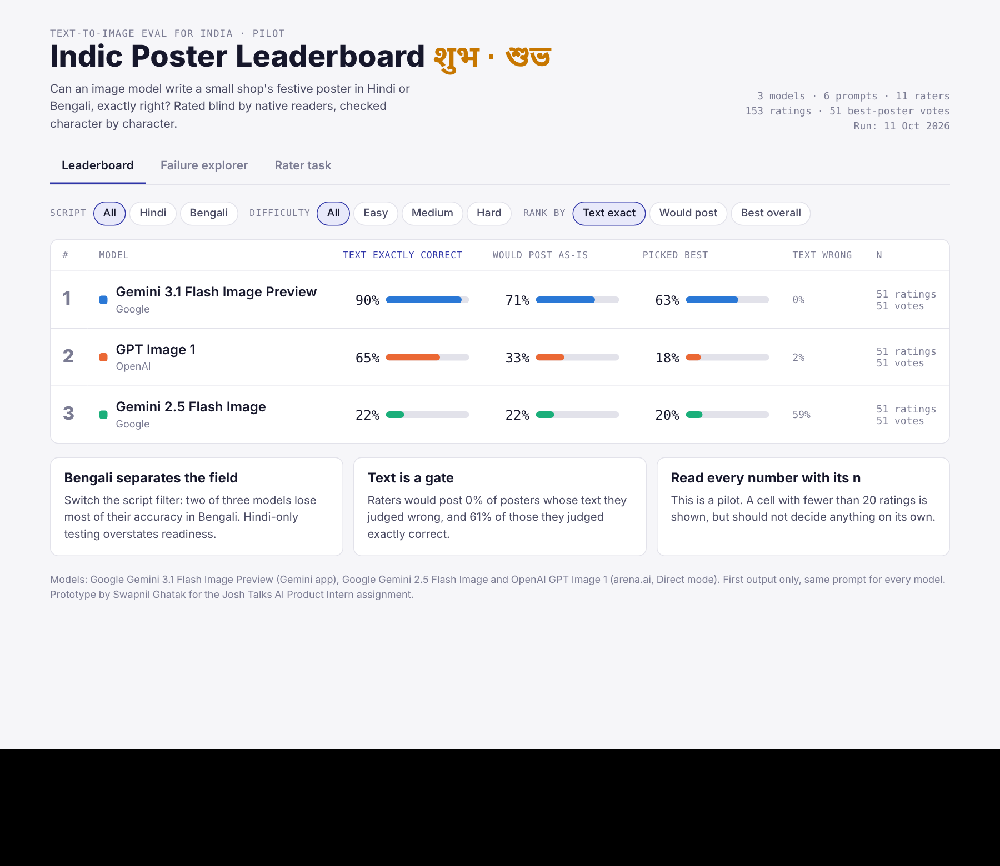
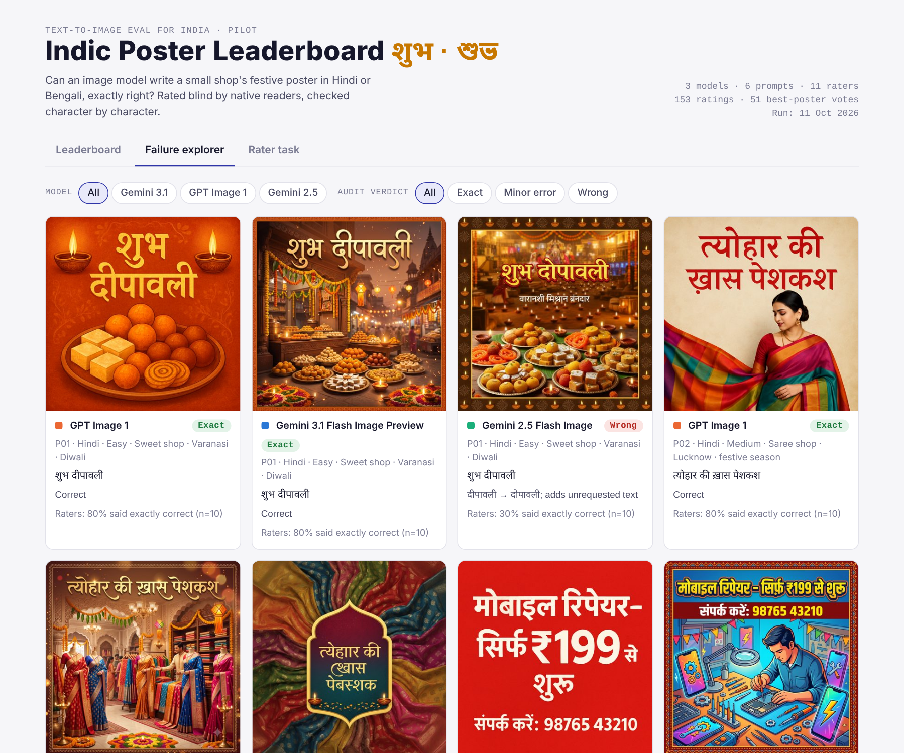
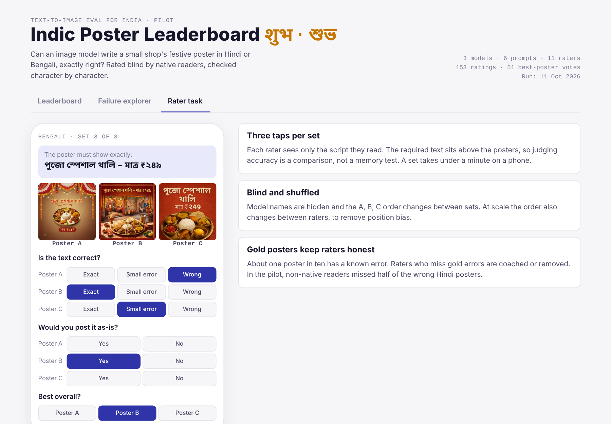

# Can AI write a shop poster in Hindi and Bengali?

A small, end-to-end evaluation of text-to-image models for an Indian use case: a local shop asks an AI model for a festive poster, and the message has to be spelt **exactly right** in Hindi or Bengali.

I designed the eval, generated the images, ran a blind study with 11 raters, checked every poster letter by letter, and built a prototype leaderboard and rating screen.

**[Live dashboard](https://YOUR-GITHUB-USERNAME.github.io/indic-poster-text-eval/dashboard/)** · **[Full report (PDF)](docs/Full_Report.pdf)** · **[One-page summary (PDF)](docs/One_Page_Summary.pdf)**



## Results at a glance

| Model | Text exactly correct | Text wrong | Would post as-is | Picked best | Correct in my letter-by-letter check |
|---|---|---|---|---|---|
| Google Gemini 3.1 Flash Image Preview | **90%** | 0% | **71%** | **63%** | **6 / 6** |
| OpenAI GPT Image 1 | 65% | 2% | 33% | 18% | 3 / 6 |
| Google Gemini 2.5 Flash Image | 22% | 59% | 22% | 20% | 0 / 6 |

*51 ratings and 51 best-poster votes per model, from 11 blind raters. Pilot-sized sample, so read the exact percentages loosely; the ranking held in every cut of the data.*

## What I found

1. **Bengali is where the models split.** Gemini 3.1 was just as accurate in Bengali (95%) as in Hindi (87%). GPT Image 1 fell from 73% to 52%, and Gemini 2.5 from 33% to 5%. Testing only Hindi would make these models look far more ready than they are.
2. **The mistakes are the ones a shop owner cares about.** A wrong price (₹২৪৯ became ₹২১৭), English digits where Bengali ones were asked for, and a single wrong letter in the word for "special".
3. **Correct text is a gate, not a winner.** Raters would post 61% of posters they judged correct and 0% of posters they judged wrong. But GPT Image 1's text was right 65% of the time and people still would only post 33% of its posters; the designs were plainer.
4. **Who rates matters as much as what's rated.** Raters who read only Hindi caught every wrong Hindi poster. Raters who said they read both scripts let 48% of them through as "exactly correct". At scale, text accuracy has to be judged by native readers, checked with known-answer posters.

| Wrong price and word | One letter off | Fully correct |
|---|---|---|
|  |  |  |
| Gemini 2.5: থালি → খালী, ₹২৪৯ → ₹২১৭ | GPT Image 1: বিশেষ → বিশেব | Gemini 3.1: correct, incl. Bengali digits |

## Why this eval

- **The user:** small Indian businesses (sweet shops, saree stores, repair shops, restaurants) that promote themselves on WhatsApp and Instagram, especially at festivals, and whose customers read regional scripts.
- **The gap:** text inside images is one of the hardest things for image models, and Indic scripts add vowel signs, conjuncts and their own digits. Most public benchmarks only test English text.
- **What "better" means**, in order: (1) the text is exactly right, (2) the shop owner would post it as-is, (3) it is preferred over the alternatives.
- **Out of scope:** English text, photorealism, art style, editing. Keeping it narrow makes the result actionable.

## How I ran it

- **Prompts:** 6 prompts in one fixed template, 3 Hindi and 3 Bengali, rising in difficulty from a two-word greeting to two lines with a price, phone number or Bengali digits. See [`data/prompts.txt`](data/prompts.txt).
- **Models:** Gemini 3.1 Flash Image Preview (Gemini app), Gemini 2.5 Flash Image and GPT Image 1 (arena.ai, Direct mode). Same prompt for every model, first output kept, no regeneration. Every generation is logged in [`data/generation_log.csv`](data/generation_log.csv) with a screenshot in [`images/generation-screenshots`](images/generation-screenshots).
- **Raters:** a Google Form built with Apps Script ([`rating-form/build_form.gs`](rating-form/build_form.gs)). Each person rated only the script they read; posters were shown as A/B/C with model names hidden. Three questions per set: is the text exactly right, would you post it, which is best. About 4 minutes.
- **Reference check:** I read both scripts, so I audited all 18 posters letter by letter and used that to measure how reliable the raters were.
- **Things that didn't go to plan** (and how I handled them) are listed in the full report: API credit limits, one generation run in the wrong arena mode, and differing image sizes.

## Product thinking: the dashboard

A clickable prototype with the real pilot data ([`dashboard/index.html`](dashboard/index.html)):

| Leaderboard | Failure explorer | Rater task |
|---|---|---|
|  |  |  |
| Rank by text accuracy, usability or preference; filter by script and difficulty; sample size on every row. | Every poster with its required text, rater verdicts and error type. What a model team would debug with. | Phone-first rating flow: required text, three unnamed posters, three taps. |

## How I'd scale it

- A prompt bank of ~50 real small-business prompts per language across all 22 scheduled languages, tagged by what each stresses (conjuncts, vowel signs, nukta, native digits), written by native speakers.
- Native-script raters only, qualified on known-answer posters, with ~1 in 10 hidden test posters in every task.
- An OCR first pass to flag obvious failures cheaply; humans make the final call because OCR struggles with decorative fonts.
- A/B/C order shuffled per rater, 3 ratings per poster, and per-character error tags.
- Per-script scores with sample sizes and confidence ranges, plus Elo-style preference scores, on a versioned public leaderboard.

## Limitations

Small pilot (6 prompts, 11 raters, one image per prompt per model); same A/B/C order for every rater within a set; free interfaces meant settings like aspect ratio couldn't be fixed; most raters were students rather than shop owners.

## Repository layout

```
docs/                     Full report and one-page summary (PDF)
dashboard/index.html      Clickable leaderboard, failure explorer and rater task
data/ratings.csv          153 anonymised ratings (rater ID, poster, verdicts, my audit)
data/best_poster_votes.csv
data/blinding_key.csv     Which A/B/C label was which model, per set
data/generation_log.csv   Model, platform, settings, time and notes for every image
data/prompts.txt
images/posters/           All 18 generated posters
images/generation-screenshots/
analysis/                 compute_results.py, make_charts.py
rating-form/              Google Apps Script that builds the blind rating form
transcriber-quality/      Companion project (see below)
assets/                   Charts and screenshots used in this README
```

To reproduce the numbers: `pip install pandas matplotlib`, then `python analysis/compute_results.py` from the repo root.

## Companion project: spotting low-quality transcribers

[`transcriber-quality/`](transcriber-quality) is a short data analysis on the reverse problem: judging *human* work with data signals instead of human raters. Using ~52,000 speech-transcription tasks, I found that leaving the AI draft unedited while spending less time than the audio lasts is the strongest warning sign (85% of such submissions disagree with other transcribers on the same clip, against 16% otherwise), and designed a staged warn → check → block system that only blocks after failing hidden known-answer clips. The dataset itself is not included.

## Privacy and how I worked

- All 11 raters were 18+ and gave consent. Their names and emails are not published here; ratings use anonymous IDs.
- I used Claude (an AI assistant) to help write the analysis code, the form script and the document drafts. The eval design, image generation, recruitment and final review are my own.

---

